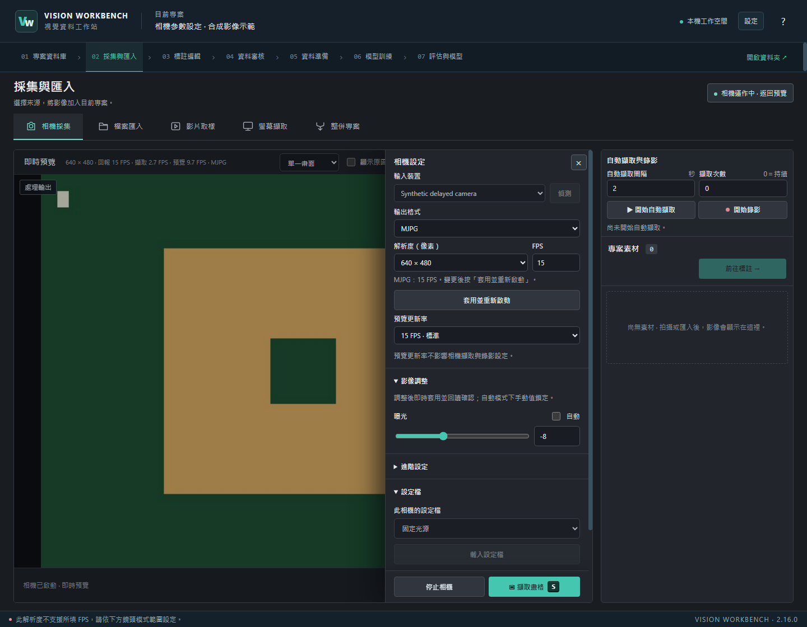

# Vision Workbench

Windows 桌面視覺資料工作台，整合影像採集、標註、審核、資料分割與模型訓練。專案資料與模型保存在本機，固定資料版本讓每次實驗的圖片、標註及增強設定可追溯。

[](https://github.com/kongbai0123/vision-workbench/actions/workflows/ci.yml)
[](CHANGELOG.md)
[](LICENSE)
[](#快速開始)

[快速開始](#快速開始) · [相機設定](docs/camera.md) · [使用指南](docs/usage.md) · [開發指南](docs/development.md) · [版本紀錄](CHANGELOG.md)

```text
採集／匯入 → 標註 → 審核 → 資料準備（分割／增強）→ 訓練 → 評估與預標註
```



*合成影像示範：右側調整相機輸出與曝光，底部操作列持續可用；可用參數依實際裝置而異。*

## 核心功能

- **資料採集**：相機、圖片、影片畫格與螢幕擷取；支援定時拍攝、錄影及原圖／處理結果比較。
- **相機控制**：輸出格式、解析度與 FPS 連動；曝光、增益、白平衡、對焦及進階畫質依裝置能力顯示，支援回讀驗證與本機設定檔。
- **標註編輯**：同視窗切換內建編輯器、Labelme 與本機 CVAT，支援 SAM2／GrabCut 輔助分割；切換或儲存影像時保留清單位置與目前選取項目。
- **資料管理**：人工審核可依有無標註分類，支援排除訓練、可還原垃圾桶與永久刪除；資料分割以「選擇方式 → 調整比例 → 檢查並套用」引導操作，Train-only 增強會逐集合列出原圖、新增事件及實際訓練量，並可直接固定為可追溯資料版本。
- **訓練設定**：增強與各模型參數按專案保存，重開分割管理器保留已套用設定；「驗證設定（不訓練）」核對固定版本、圖片雜湊、輸入量、批次及引擎支援差異。
- **進度與剩餘時間**：背景匯入、安裝、採集與訓練一律顯示確定型進度條；取得真實工作量後以 `HH:MM:SS` 顯示秒級剩餘時間並持續校正，初始化期間明確標示「剩餘時間計算中」。
- **模型訓練**：支援物件偵測、實例分割、語意分割與圖片分類，提供訓練曲線及模型比較；固定資料版本保存分割與增強配方，編輯草稿不會改寫歷史版本。
- **外部模型匯入**：可從檔案總管拖曳或用檔案瀏覽器選擇 Ultralytics 相容的 YOLO／RT-DETR `.pt` 權重；驗證後用於圖片／影片試跑與預標註，並保留來源與類別資訊。
- **模型中心**：以總覽、訓練設定、評估報告、辨識對照與外部試跑分頁呈現；評估可下載 JSON，Batch 對照可篩選 TP／FP／FN 並下載 PNG、JSON、CSV。
- **模型試跑與比對**：模型清單、試跑與標註比對共用明確的目前版本；結果保留來源模型提示，預測標籤字體不低於 12px。
- **資料匯出與匯入**：在「開啟資料夾」旁進入「資料匯出」，將已核准的圖片、標註與分割輸出為 COCO、YOLO、LabelMe、JSONL 或原生格式及可攜式 ZIP；匯入時可選整份資料夾，也可選資料集中的圖片並自動配對標註。

## 跨主機搬移圖片與標註

在來源主機按「資料匯出」，選擇格式、完成驗證並建立版本。進行 YOLO 偵測訓練時可選「YOLO · 物件偵測」；匯出會產生 `data.yaml`、`images/`、`labels/` 與 ZIP。將 ZIP 複製到另一台主機並**完整解壓縮**，即可用 `data.yaml` 訓練，或在 Vision Workbench 的「採集與匯入」選擇解壓後的資料夾。

若只選資料集內的圖片，工作台會從上層資料集尋找配對標註；匯入預覽會顯示每張圖片的標註數。已先匯入但尚無標註的相同原圖，可再次匯入有標註的版本補入標註，圖片會回到待審核。已有不同標註的原圖不會被覆蓋，匯入結果會列出衝突。ZIP 是圖片與標註的交換封裝，不包含模型權重或完整工作台資料庫。

## 從資料審核到訓練設定

| 階段 | 操作 | 保存與使用方式 |
| --- | --- | --- |
| 04 資料審核 | 檢查標註並核准影像 | 修改已核准標註後，圖片回到待審核 |
| 05 資料準備 | 套用分割、設定增強，建立 Dxxx 固定版本 | 凍結圖片、標註、Train／Validation／Test 與增強配方 |
| 06 訓練設定 | 選取 Dxxx、模型與參數 | 後續訓練使用所選版本；05 新草稿不會覆蓋舊版本 |

例如 100 張原圖分成 Train 60／Validation 20／Test 20，每張 Train 原圖額外載入 2 次，支援擴充的引擎每輪接收 180 筆 Train 輸入；Validation／Test 各保持 20 張。內建像素基準不使用擴充，會顯示實際讀取的原圖數。

06 的「快速估時（不訓練）」讀取相同設定的歷史耗時；「驗證設定（不訓練）」另外檢查圖片完整性及引擎相容性。兩者都不會建立訓練工作。首次沒有相符耗時紀錄時，實際執行後才由首批資料提供初估；ETA 是會更新的預估值，詳見[算法與誤差紀錄](docs/time-estimation.md)。

## 相機參數工作流程

在「採集與匯入 → 相機採集 → 相機設定」完成拍攝設定，直接對照左側即時預覽。

1. **選擇輸出**：偵測裝置，選擇自動／指定格式、解析度與 FPS；運作中可按「套用並重新啟動」。
2. **調整影像**：切換自動／手動曝光與白平衡，用滑桿或數值欄位微調；每次套用都回讀驅動結果。
3. **保存條件**：替目前設定命名，下一次停機時載入並啟動；快照來源紀錄保留相機參數。

預覽更新率可獨立選擇 5／10／15／30 FPS。介面分別顯示驅動回報、擷取與預覽幀率，輸出不符或持續低幀率時提供提示。停止與擷取按鈕固定於面板底部。

硬體參數目前透過 Windows DirectShow 提供；可用項目與範圍取決於相機及驅動。裝置不支援的控制項不會顯示，切換至其他擷取後端時仍可使用基本預覽與採集。詳見[相機設定與疑難排解](docs/camera.md)。

## 快速開始

需要 Windows 10／11（64 位元）與 Python 3.13。首次安裝需連線下載套件。

```powershell
git clone https://github.com/kongbai0123/vision-workbench.git
cd vision-workbench
powershell -NoProfile -ExecutionPolicy Bypass -File .\bootstrap.ps1
.\vision-workbench.bat
```

後續直接開啟 `vision-workbench.bat`。

啟動前會檢查 Python 版本、64 位元架構、固定套件版本及核心桌面元件。環境缺失時自動嘗試安裝一次，失敗會停留在錯誤畫面並提供紀錄位置。重建不相容的環境前，會將原環境保留為 `.venv-backup-<時間>-<識別碼>`；資料與模型保存在原位置。

只產生診斷、不安裝套件或開啟桌面：

```powershell
powershell -NoProfile -ExecutionPolicy Bypass -File .\launch.ps1 -Diagnose
```

修復環境但不開啟桌面：

```powershell
powershell -NoProfile -ExecutionPolicy Bypass -File .\launch.ps1 -Repair
```

若 Windows 顯示「不明發行者／已保護您的電腦」，先確認下載來源，再依[啟動疑難排解](docs/startup-troubleshooting.md)處理特定檔案的下載封鎖。此來源版本沒有附帶簽署的 Windows 安裝程式；啟動腳本無法在 Windows 封鎖它之前自行執行檢查。

訓練模型的選配環境可於「設定 → 模型與元件」安裝。SAM2 與 CVAT 的準備方式見[使用指南](docs/usage.md)。

### 更新既有安裝

工作台「設定 → 更新與版本」會追蹤 GitHub 的版本標籤並提示新版。按一次「從 GitHub 更新」即可保存工作內容、自動備份本機程式修改、下載並驗證新版，再自動重新啟動。訓練或匯入尚在進行時，更新會等待工作完成後繼續；下載失敗時保留原內容並可重試。

必要的主程式依賴會在舊程序退出後自動同步，自訂資料位置也會沿用。專案資料、模型與虛擬環境不會被 Git 更新覆蓋。本機程式修改保存在 `.git/workbench-update-backups/` 的復原紀錄與 Git 備份物件，不會自動套回並覆蓋新版。

開發者也可在關閉工作台後手動更新：

```powershell
git pull --ff-only
powershell -NoProfile -ExecutionPolicy Bypass -File .\bootstrap.ps1
```

v2.20.0 新增 `tqdm` 依賴，已安裝的 TorchVision／Ultralytics 環境也需在「設定 → 模型與元件」執行安裝／修復。安裝依賴不會啟動訓練。資料庫升級前會自動備份；固定資料版本與歷史結果保留。

## 文件

- [使用指南](docs/usage.md)：選配元件、標註流程、資料分割、模型評估與備份。
- [相機設定](docs/camera.md)：輸出模式、即時硬體參數、設定檔與 FPS 診斷。
- [模型匯入與試跑](docs/model-assistance-workflows.md)：外部權重、預標註、資料交換及相容性限制。
- [開發指南](docs/development.md)：本機開發、程式結構與測試。
- [啟動疑難排解](docs/startup-troubleshooting.md)：Windows 信任警告、Python／套件修復與診斷紀錄。
- [04–06 設定與儲存驗證](docs/setup-workflow-audit.md)：設定如何生效、擴增數量、資料權威來源與不啟動訓練的驗證範圍。
- [時間估算與回放驗證](docs/time-estimation.md)：tqdm 整合、快速初估、分階段校正與實測誤差。
- [版本紀錄](CHANGELOG.md)
- [問題回報](https://github.com/kongbai0123/vision-workbench/issues)

## 回報問題與參與開發

歡迎提交 Issue 或 Pull Request。回報相機問題時，請附上軟體版本、Windows 版本、相機型號、要求與實際輸出模式、重現步驟，以及不含私人影像的截圖。開發前請先閱讀[開發指南](docs/development.md)，並執行對應的 Python、JavaScript 與桌面流程測試。

## 授權

本專案採用 [MIT License](LICENSE)。第三方元件與模型權重適用各自授權，選用前請查閱元件說明。
